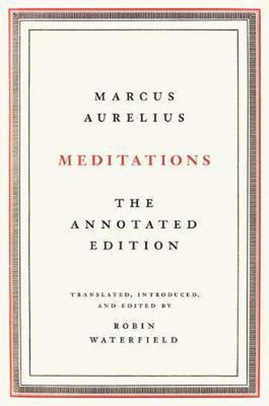
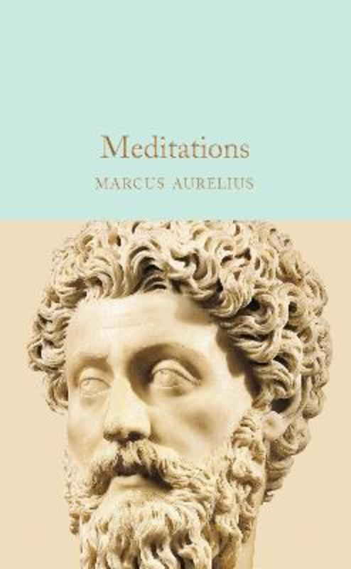

# 📖 Reading Tracker

A tracker for books I'm reading to improve my English naturally — not textbooks, but real books for leisure.

---

## ⚠️ A Common Mistake: Don't Start with Philosophy Books!

When I decided to improve my English through reading, I made a classic mistake: **I picked a philosophy book about Stoicism** (think Marcus Aurelius, Seneca, Epictetus). 

The result? I was marking **40+ new words per chapter**. It was overwhelming and unsustainable.

### Why Philosophy Books Are Hard for Language Learners

| Problem | Example |
|---------|---------|
| **Archaic vocabulary** | Words like "hitherto", "thereof", "whereupon" |
| **Abstract concepts** | Discussing virtue, fate, tranquility in complex ways |
| **Formal/academic tone** | Long, complex sentence structures |
| **Rare words** | Vocabulary you'll rarely encounter in daily life |
| **Translation artifacts** | Ancient texts translated into overly formal English |

### The Realistic Approach

For effective vocabulary acquisition, aim for:
- **5-10 new words per chapter** (not 40+!)
- Words you'll actually use in conversations
- Modern, everyday English
- Topics you genuinely enjoy

> 💡 **Pro tip:** If you love philosophy, try modern authors like Ryan Holiday who write about Stoicism in accessible, contemporary English. Save the ancient texts for when you're at C1+ level!

> ✅ **Update (2026):** That's what I did. Once I reached C1 (IELTS 8.0), I went back to Stoicism and finished *Meditations*. Now I'm reading *Meditations: The Annotated Edition*, which comes with a full introduction and notes.

---

## 📚 My Reading List

### Currently Reading

| Cover | Title | Author | Genre |
|-------|-------|--------|-------|
|  | **Meditations: The Annotated Edition** | Marcus Aurelius (translated by Robin Waterfield) | Philosophy / Stoicism |

### Completed

| Cover | Title | Author | Genre |
|-------|-------|--------|-------|
|  | **Meditations** (Macmillan Collector's Library) | Marcus Aurelius (translated by A. S. L. Farquharson) | Philosophy / Stoicism |

---

## 💡 Tips for Reading in English

1. **Choose books slightly below your level** — You should understand 90-95% without a dictionary
2. **Don't look up every word** — Try to guess from context first
3. **Read topics you enjoy** — Background knowledge helps comprehension
4. **Try audiobook + physical book** — Great for pronunciation and listening skills
5. **Keep a vocabulary notebook** — But limit yourself to 5-10 words per session
6. **Re-read favorite passages** — Repetition reinforces learning
7. **Discuss what you read** — With friends, online communities, or AI assistants

---

**Last Updated:** November 2026
